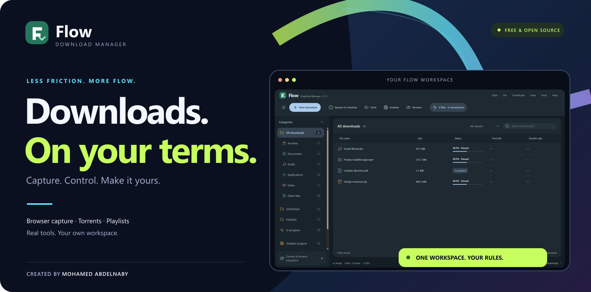
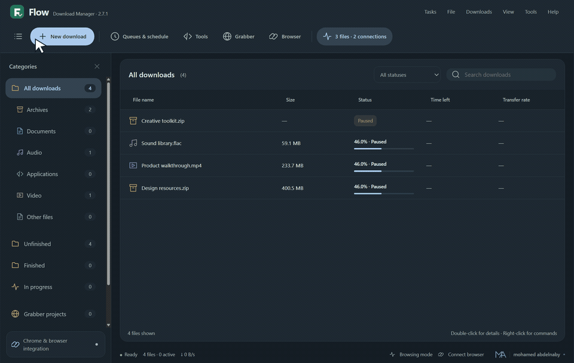
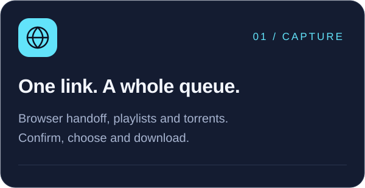
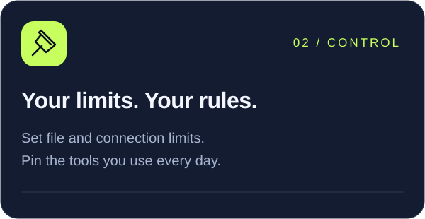
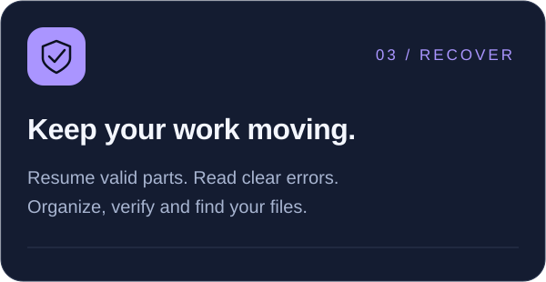
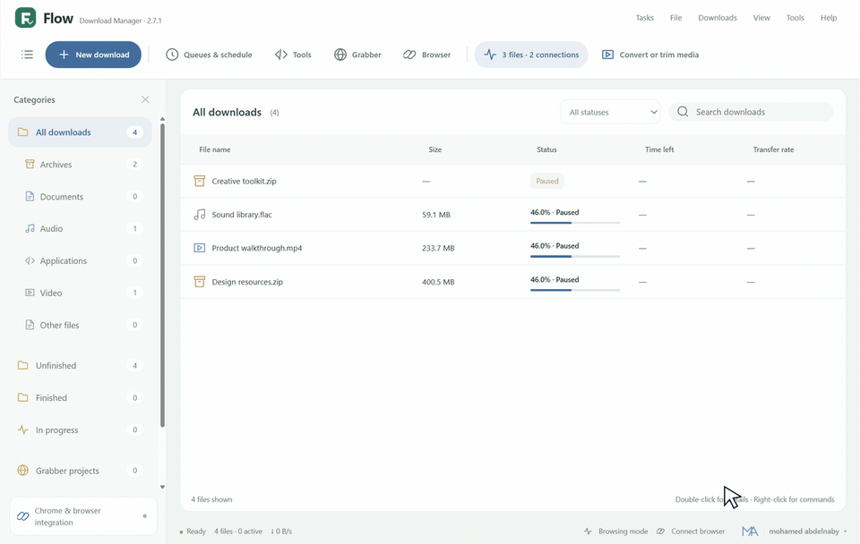
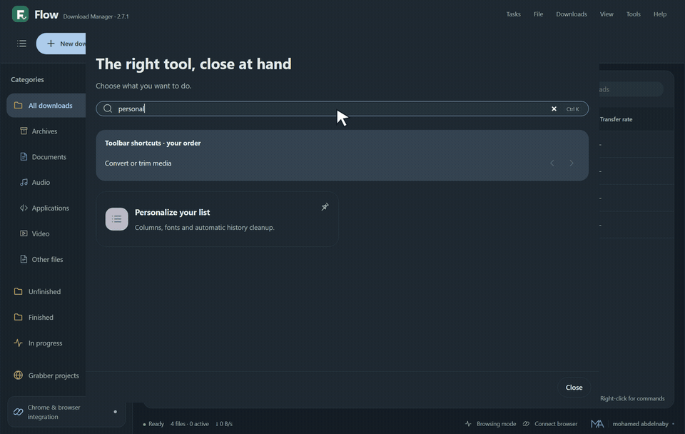
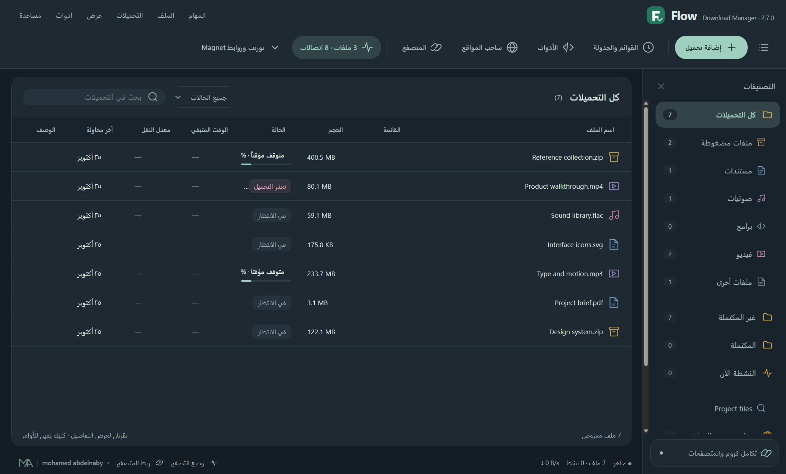
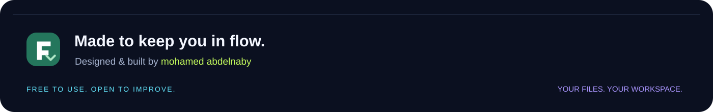

  

[Explore the tools](docs/TOOLS.md) · [Browser setup](BROWSER-INTEGRATION.md) · [Full gallery](docs/SCREENSHOTS.md) · [What's new](CHANGELOG.md) · [Report a problem](https://github.com/Mohamedabdelnaby1/flow-download-manager/issues/new?template=bug_report.yml)

   

**Free to use. Open to improve. Built around your workflow.**

### Find it. Pin it. Keep it close.

A real mouse-and-keyboard workflow in Flow 2.7.1. Each GIF on this page is a separate, continuously recorded task.

<table><tr>
<td width="33%"></td>
<td width="33%"></td>
<td width="33%"></td>
</tr></table>

**Capture** browser downloads, website videos, playlists, torrents and magnet links. **Control** how many files and connections run, choose queues and pin up to eight tools. **Recover and organize** with resume, integrity checks, clear errors, tags and file tools. [Explore the full toolkit →](docs/TOOLS.md)

### Complete · the main Windows edition

Everything bundled in the Electron edition. **Setup: 148.1 MB · Portable: 147.9 MB.**

 

### Compact Preview · a smaller optional host

The same interface and full Node, FFmpeg, aria2 and video-extraction tools, using shared **Microsoft WebView2 + .NET Framework 4.8**. These system prerequisites are outside the reported download size. This remains an optional preview. [Compare editions →](docs/COMPACT-WINDOWS-PREVIEW.md)

 

**Updating? Use Setup to replace the existing installation.** Portable opens separately. Exit Flow from the tray before updating. [Update walkthrough](docs/UPDATING.md) · [All release files](https://github.com/Mohamedabdelnaby1/flow-download-manager/releases/latest) · [Checksums](https://github.com/Mohamedabdelnaby1/flow-download-manager/releases/download/v2.7.1/SHA256SUMS.txt)

### See it move. Stay in control.

Progress, speed, remaining time, pause, cancel and tray access. Details are there when you need them.

### Same Flow. Your atmosphere.

Choose your accent, density, corners, fonts, columns and motion. Follow your system or keep your own appearance.

Recorded in an isolated example library, with a synchronized cursor overlay. The transfer GIF shows a completed 3 MiB local download; it is not an internet-speed benchmark. <a href="docs/demos/capture-notes.json">Capture notes</a>.

<b>Open the full toolkit</b> — useful tools, without a crowded workspace

| Download | Organize | Make it yours |
| :--- | :--- | :--- |
| Segmented HTTP/HTTPS and FTP resume | Favorite folders, tags and saved views | Up to eight pinned tool shortcuts |
| Browser handoff with a separate confirmation | Batch rename with a preview | Simple file and connection limits |
| Website qualities, audio merging and playlists | Verified moves and integrity checks | Six accents and layout preferences |
| Torrents, magnets and file selection | Recovery bin and duplicate cleanup | Light, dark and system appearance |
| Verified same-file mirrors | Selective ZIP and local media tools | English and Arabic RTL |

Also included: queue scheduling, completion actions with cancellable shutdown, expired-link rescue where identity can be verified, local-network phone control, organization rules and safe configuration backup. Open **Tools** or press **Ctrl+K**. Advanced controls stay collapsed. [Tool guide →](docs/TOOLS.md)

<b>Arabic RTL, static screenshots and full-size views</b>

[Open the complete gallery →](docs/SCREENSHOTS.md)

### Get connected in three steps

1. **Open Flow.** Paste a link into **New download**, choose a destination and start or queue it.
2. **Connect the browser.** Open **Browser integration**, prepare the connection and load the companion once in Chrome, Edge or Brave. [Illustrated instructions →](BROWSER-INTEGRATION.md)
3. **Make it comfortable.** Pin your usual tools, set your download limits and pick an appearance.

The companion currently needs a manual **Load unpacked** step because it is not in a browser store. Portable editions save data in your Windows profile; they are not zero-footprint USB applications.

Flow is an independent, AI-assisted project by **mohamed abdelnaby**. The original source is **MIT licensed**; dependencies retain their own licenses. Flow has no affiliation with IDM and contains no Tonec binaries.

| Explore | Build & contribute |
| :--- | :--- |
| [Feature reference](FEATURES.md) · [Changelog](CHANGELOG.md) | [Development guide](docs/DEVELOPMENT.md) · [Source ZIP](https://github.com/Mohamedabdelnaby1/flow-download-manager/releases/download/v2.7.1/Flow-2.7.1-Source.zip) |
| [Validation evidence](VALIDATION.md) · [Known boundaries](docs/LIMITATIONS.md) | [Report a bug](https://github.com/Mohamedabdelnaby1/flow-download-manager/issues/new?template=bug_report.yml) · [Suggest a feature](https://github.com/Mohamedabdelnaby1/flow-download-manager/issues/new?template=feature_request.yml) |
| [Privacy and security](SECURITY.md) · [Third-party notices](THIRD-PARTY-NOTICES.md) | [Contributing](CONTRIBUTING.md) · [MIT license](LICENSE) |

<b>Compatibility, validation and current limits</b>

Windows 10/11 x64. Windows 7/8/8.1 are unsupported, Linux packages are deferred, and executables remain unsigned. [Publisher signing](docs/WINDOWS-SIGNING.md).

Both 2.7.1 package jobs passed 250 source tests. The actual installed upgrade preserved its library, settings and two completed-file hashes. Compact Preview has separate payload and native integration evidence. The 170-check UI baseline describes 2.7.0's unchanged interface. [Read the exact results →](VALIDATION.md)

Website restrictions, authentication and extractor changes can affect downloads. Flow does not decrypt DRM or promise a fixed speed multiplier. The updater announces releases and opens the official page; unattended installation/rollback, playlist subscriptions, general ZIP/7Z/RAR auto-extraction and cross-device sync remain future work.

<a href="https://github.com/Mohamedabdelnaby1">GitHub</a> · <a href="https://www.facebook.com/mohamedabdelnaby190">Facebook</a> · <a href="LICENSE">MIT License</a>

