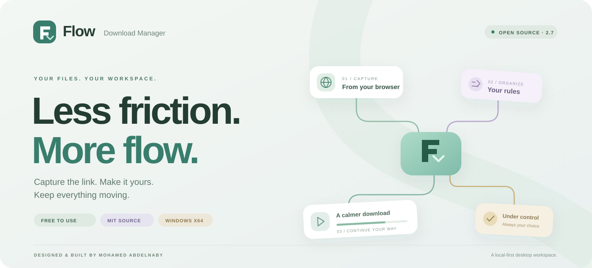
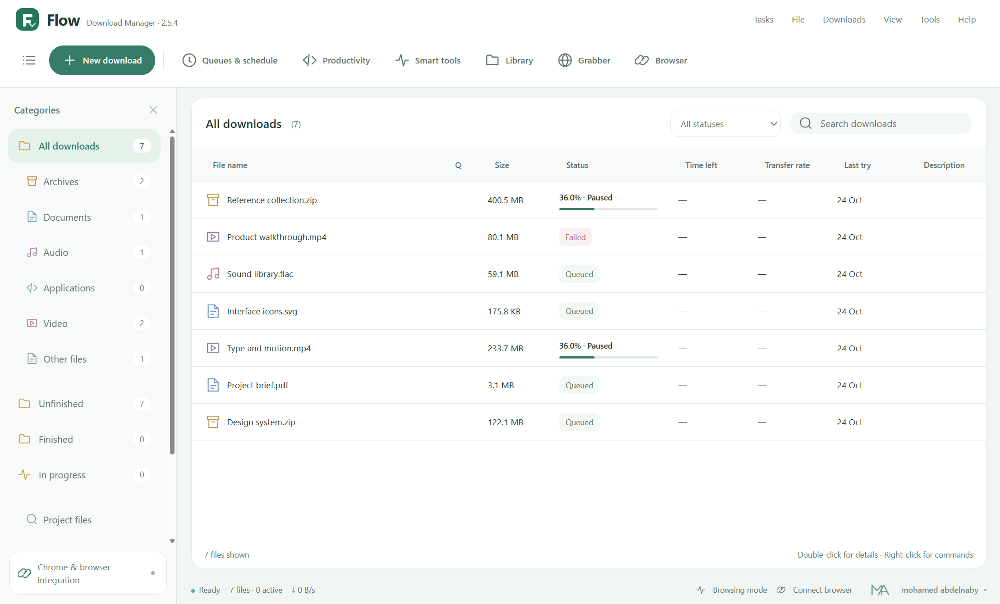
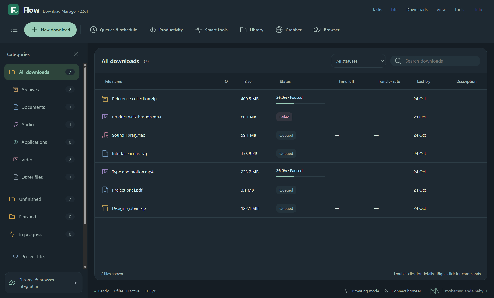
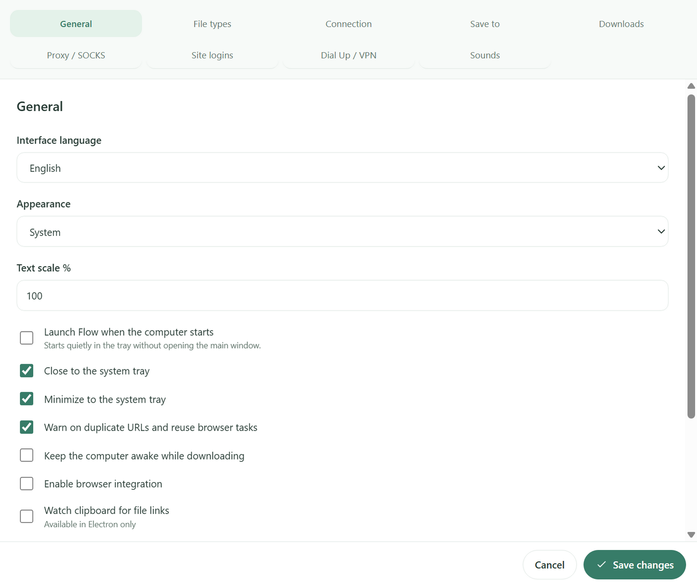
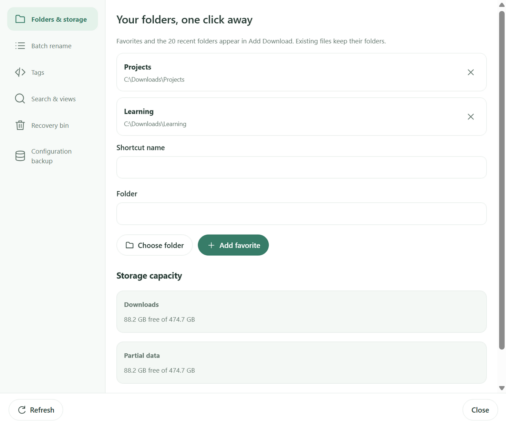
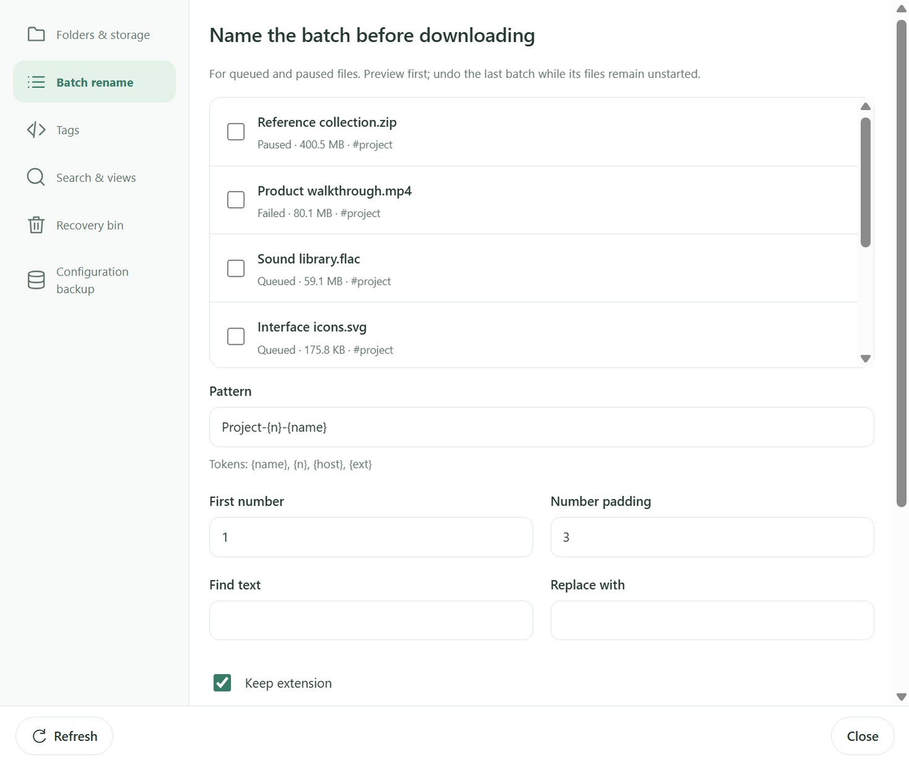
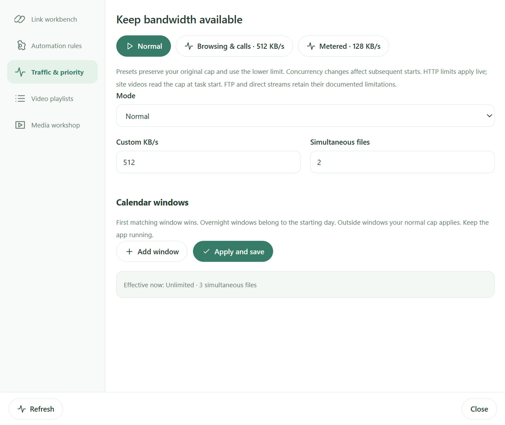
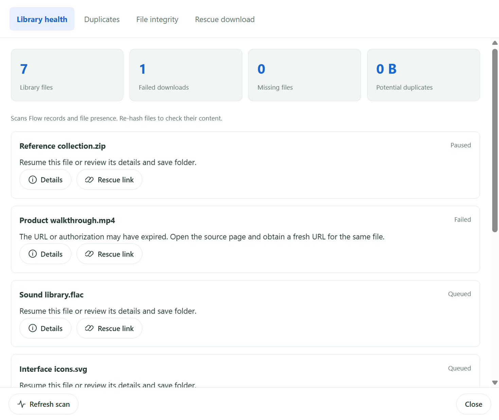
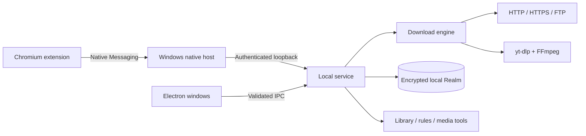

<div align="center">



# Flow Download Manager

**A Windows download manager with browser handoff, an encrypted local library, and tools for the whole download workflow.**


[](LICENSE)


[**Download for Windows**](https://github.com/Mohamedabdelnaby1/flow-download-manager/releases/latest) آ· [Features](FEATURES.md) آ· [Browser setup](BROWSER-INTEGRATION.md) آ· [Development](docs/DEVELOPMENT.md) آ· [Report a problem](https://github.com/Mohamedabdelnaby1/flow-download-manager/issues/new/choose)

</div>



## A calmer workspace in 2.5.4

A consistent Material-inspired interface across the main library, settings and tools: sage green surfaces, muted category colors, slim progress tracks, contextual file actions and compact transfer/completion windows. English and Arabic layouts follow light, dark or system appearance.

Startup can stay quietly in the system tray, which shows transfer size and speed. Renderer recovery keeps the download service running independently; adaptive reconnects preserve validated partial data. [Stability details](docs/STABILITY.md).

## Update notifications

Flow checks published GitHub releases at startup and every six hours, with a separate update window and a download-page button. Use **Help → Check for updates**, defer a reminder, skip a version or turn automatic checks off. [How updates work](docs/UPDATES.md).

## Reliability update in 2.5.2

Menus now close consistently, browser handoff opens separate desktop windows, and the companion refreshes obsolete overlays. The installer offers repair/update, reinstall and uninstall for an existing copy. See [upgrade guidance](docs/UPGRADE.md) and [validation](VALIDATION.md).

## Built around the actual workflow

Send a file from the browser. Confirm its destination in a separate desktop window. Pause, resume, organize and verify it. Flow keeps the task, its partial data and the surrounding tools in one local system.

Free to download and use. Original Flow code and artwork are open source under the [MIT License](LICENSE); third-party components retain their own licenses.

Created by **mohamed abdelnaby** — [Facebook](https://www.facebook.com/mohamedabdelnaby190).

## Download

| Edition | Best for | Download |
| :--- | :--- | :--- |
| **Installer** | Shortcuts, Start menu and a standard uninstall entry | [Flow-2.5.4-Setup.exe](https://github.com/Mohamedabdelnaby1/flow-download-manager/releases/download/v2.5.4/Flow-2.5.4-Setup.exe) |
| **Portable launcher** | Launch without running the installer | [Flow-2.5.4-Portable.exe](https://github.com/Mohamedabdelnaby1/flow-download-manager/releases/download/v2.5.4/Flow-2.5.4-Portable.exe) |
| **Browser companion** | Chrome, Edge, Brave and Chromium | [Flow-Companion-2.5.4.zip](https://github.com/Mohamedabdelnaby1/flow-download-manager/releases/download/v2.5.4/Flow-Companion-2.5.4.zip) |
| **Source bundle** | Source, tests, docs and screenshots | [Flow-2.5.4-Source.zip](https://github.com/Mohamedabdelnaby1/flow-download-manager/releases/download/v2.5.4/Flow-2.5.4-Source.zip) |

Windows x64. Executables are unsigned. Portable skips installation but still stores data in your Windows profile; enabling native browser integration registers a host for your user. It is not a zero-footprint USB edition. Verify files using the release's [SHA256SUMS.txt](https://github.com/Mohamedabdelnaby1/flow-download-manager/releases/download/v2.5.4/SHA256SUMS.txt).

## What you can do

| Download | Organize | Control |
| :--- | :--- | :--- |
| Segmented HTTP/HTTPS with safe range validation | Favorite and recent folders | Per-file, global and shared queue HTTP limits |
| Pause, resume and persistent checkpoints | Batch rename with preview and guarded undo | Schedules, quotas and traffic profiles |
| FTP transfer and byte-offset resume | Tags, compound search and saved views | Rules by host and extension |
| Website quality selection and audio merging | Recovery bin for tasks and partial data | Capture snooze and site exclusions |
| Unencrypted HLS/DASH assembly | Missing-file checks and duplicate candidates | SHA-256 verification and URL rescue |
| Public YouTube playlist selection | Selective configuration backup | Media conversion, trim and resolution limits |

English by default, with optional Arabic RTL. **System, Light and Dark appearance**, live system changes, 80–150% text scaling and independently resizable/minimizable tool windows.

### Browser handoff you can control

- Native Messaging connects to Flow and can launch the app when needed.
- Confirmation and progress open in separate desktop windows.
- Chrome cancels its copy only after Flow acknowledges handoff; failed handoffs resume Chrome's download.
- Pause capture for 15 minutes, exclude a site or bypass a link with **Alt + click**.
- Drag, minimize, close or reset the floating video panel; position persists per host.
- Fragment URLs and signed duplicates are filtered. Website videos use readable titles and a quality picker.

[Set up the extension →](BROWSER-INTEGRATION.md)

## A closer look

<table>
<tr><td width="50%"><br><b>Dark appearance</b><br>Follow Windows or choose your palette.</td><td width="50%"><br><b>Your interface</b><br>Language, appearance and text scaling.</td></tr>
<tr><td><br><b>Library and storage</b><br>Destinations and disk capacity within reach.</td><td><br><b>Prepare a batch</b><br>Preview filenames before applying changes.</td></tr>
<tr><td><br><b>Rules and traffic</b><br>Organize repetitive work and bandwidth.</td><td><br><b>Inspect and recover</b><br>File presence, integrity and failed downloads.</td></tr>
</table>

Real desktop captures with demonstration records. They do not prove universal website support or support for every browser profile. [Gallery →](docs/SCREENSHOTS.md)

## Get started

1. Download an edition from [Releases](https://github.com/Mohamedabdelnaby1/flow-download-manager/releases/latest).
2. Choose **Add URL**, or prepare integration from **Browser** in the toolbar.
3. Inspect the link, choose destination/quality, then **Start download** or **Download later**.
4. Use **Options → General** for English/Arabic, System/Light/Dark and text size.

Closing the main window keeps Flow in the tray. Use **Tasks → Exit** or the tray's **Exit** to quit. Before upgrading, exit older versions, then reload the extension and affected browser tabs.

## Build and develop

```powershell
npm ci
npm run native
npm test
npm start
```

Build both Windows editions with `npm run dist`. Development requires Node.js 22.12+; Node 22 is the tested build line. Windows .NET Framework's compiler builds the native host. End users need no separate Node.js or Python installation. [Development guide →](docs/DEVELOPMENT.md)

## Architecture



HTML/CSS/JavaScript UI, sandboxed renderers, context isolation and a bounded preload API. Realm stores tasks/settings locally; desktop keys use the OS secure store. [Architecture and data handling →](docs/ARCHITECTURE.md)

## Validation and boundaries

See [validation](VALIDATION.md) for current local results, earlier evidence and unverified scenarios. Flow does not decrypt DRM, provide torrents, sync across devices or promise every website. Live authenticated Facebook downloads and a personal Chrome/Edge extension installation remain unverified. Transport-specific speed limits are explained in [limitations](docs/LIMITATIONS.md).

## Project information

[Changelog](CHANGELOG.md) آ· [Contributing](CONTRIBUTING.md) آ· [Security](SECURITY.md) آ· [Research](RESEARCH-AND-UPGRADES.md) آ· [Third-party notices](THIRD-PARTY-NOTICES.md) آ· [Copyright](COPYRIGHT.md)

Flow is independent. It contains no Tonec IDM binaries and claims no affiliation with IDM.

<div align="center"><sub>Flow آ· Crafted by <a href="https://www.facebook.com/mohamedabdelnaby190">mohamed abdelnaby</a></sub></div>

### Playlist downloads and recovery

Import a complete YouTube playlist, choose a quality, skip existing videos, retain episode numbers and download selected items in one queue. [Playlist guide](docs/PLAYLISTS.md). Incomplete recovery records no longer break every tool window; failed links and connecting tasks now have bounded deadlines and cancellable inspection.

### Quiet startup, tray progress and idle recovery

Flow can start quietly with Windows, close/minimize to the tray, show transferred/total bytes and speed in the tray tooltip, and reopen individual transfers from the tray menu. Installed and portable startup use a permanent launcher instead of the extraction directory. Transfer and completion windows have compact material surfaces, with technical details collapsed.

Renderer crashes/hangs trigger bounded interface recovery while the native transfer engine stays alive. Software rendering is the compatibility default. Hidden windows stop UI polling; unchanged data does not rebuild the download list. Libraries are paginated at 200 rows. HTTP transfers adapt connection counts after overload, retry productive interrupted ranges and retain validators/range checks. [Stability and startup guide](docs/STABILITY.md).

### Included sounds and video-tool recovery

Three short original WAV sounds are included for completion, failure and queue completion, with direct preview and custom-file reset. A missing/corrupt extractor can be restored from the pinned official release after checksum verification. The 2.5.4 packaged check fully downloaded and decoded the exact user-supplied YouTube video; site availability and access restrictions still apply. Transfer windows provide explicit cancellation with confirmation. Clicking the tray icon restores the last minimized transfer. [Validation](VALIDATION.md).
