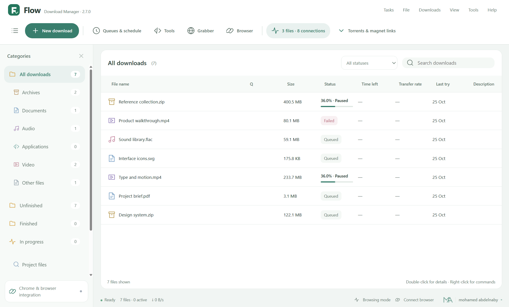
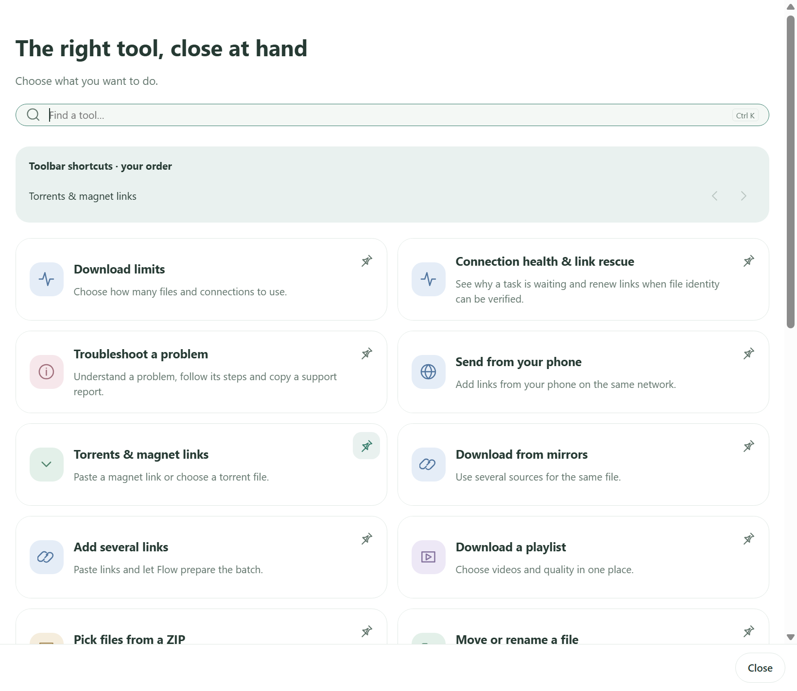
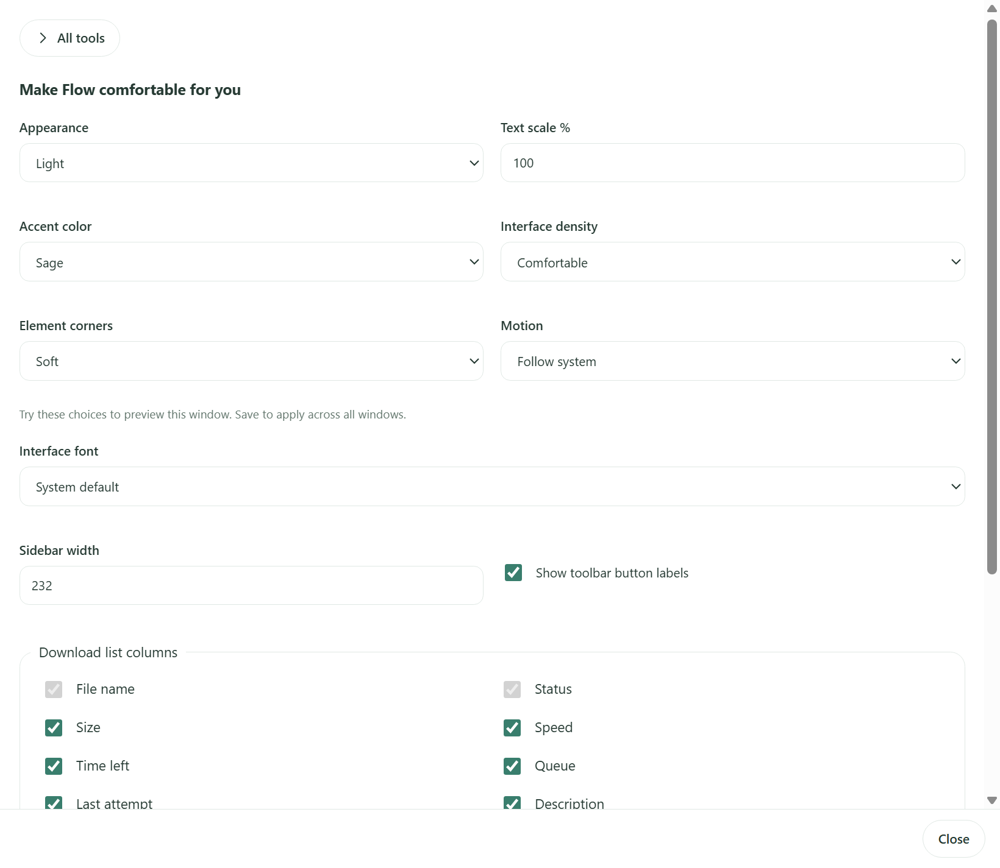
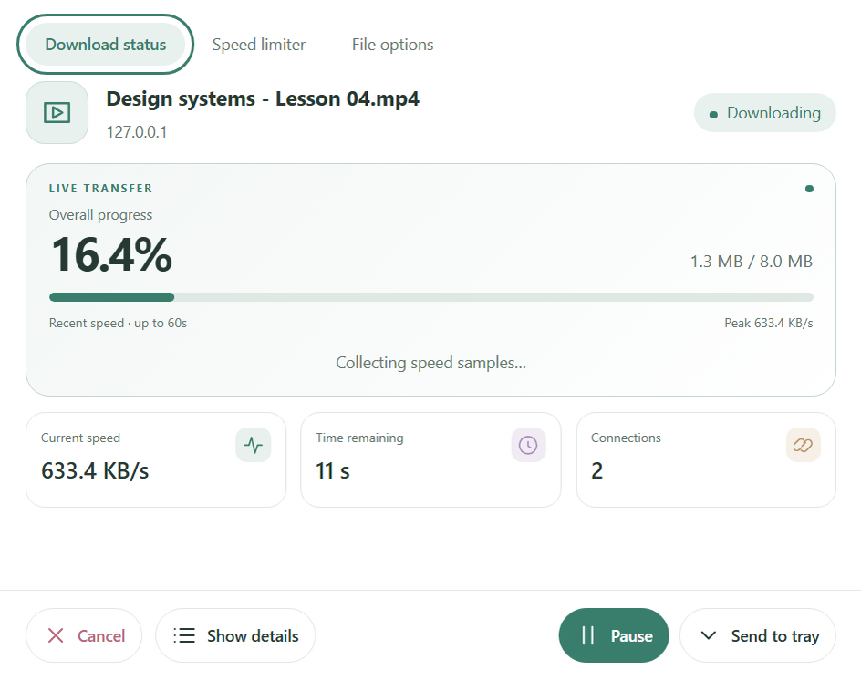
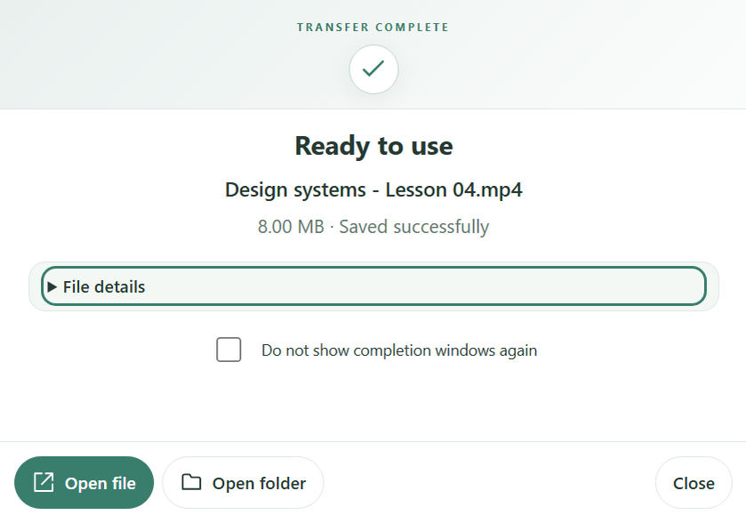
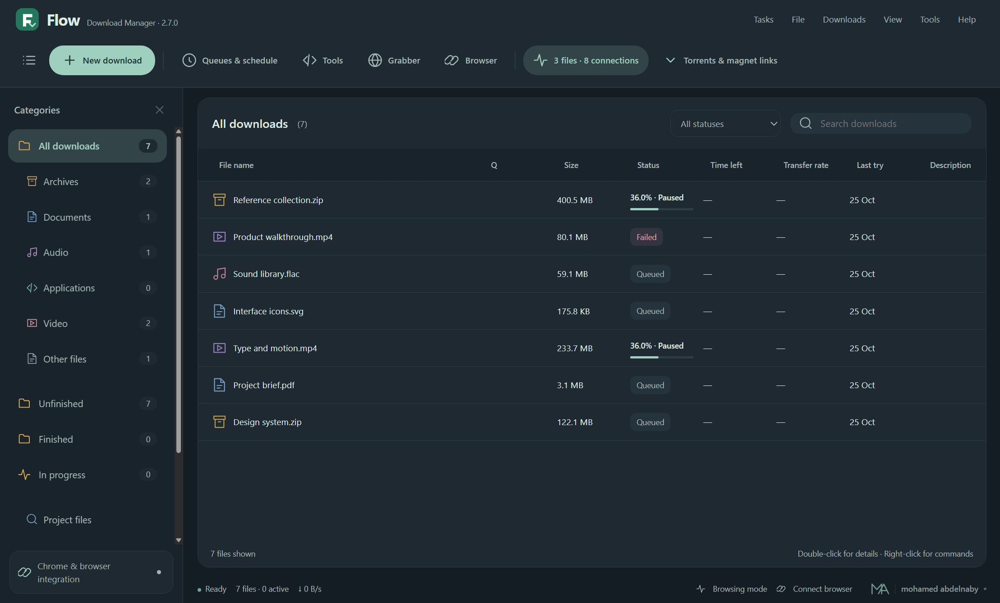

<div align="center">


**A calmer home for your downloads.**

Browser capture, playlists, torrents, queues and useful file tools — in one customizable Windows workspace.

[Download](#choose-your-flow) · [Explore the tools](#more-than-a-download-list) · [Browser setup](BROWSER-INTEGRATION.md) · [Gallery](docs/SCREENSHOTS.md) · [Build it](docs/DEVELOPMENT.md)

 [](LICENSE)  [](https://github.com/Mohamedabdelnaby1/flow-download-manager/releases/latest)

</div>



<p align="center"><sub>Actual application captures with demonstration records. Light, dark and Arabic layouts share the same workspace.</sub></p>

## Choose your Flow

**Free to use. Open to inspect, modify and improve.** No paid edition is required to unlock the tools below.

| Edition | Install | Run without installing | Download size |
| :--- | :--- | :--- | :--- |
| **Complete** · retained compatibility choice | [Windows setup](https://github.com/Mohamedabdelnaby1/flow-download-manager/releases/download/v2.7.0/Flow-2.7.0-Setup.exe) | [Portable](https://github.com/Mohamedabdelnaby1/flow-download-manager/releases/download/v2.7.0/Flow-2.7.0-Portable.exe) | 146.8 / 146.6 MB |
| **Compact Preview** · optional smaller host | [Compact setup](https://github.com/Mohamedabdelnaby1/flow-download-manager/releases/download/v2.7.0/Flow-2.7.0-Compact-Preview-Setup.exe) | [Compact portable](https://github.com/Mohamedabdelnaby1/flow-download-manager/releases/download/v2.7.0/Flow-2.7.0-Compact-Preview-Portable.exe) | **59.5 / 62.1 MB** |

[All release files](https://github.com/Mohamedabdelnaby1/flow-download-manager/releases/tag/v2.7.0) · [SHA-256 checksums](https://github.com/Mohamedabdelnaby1/flow-download-manager/releases/download/v2.7.0/SHA256SUMS.txt) · [Companion extension](https://github.com/Mohamedabdelnaby1/flow-download-manager/releases/download/v2.7.0/Flow-Companion-2.7.0.zip) · [Source ZIP](https://github.com/Mohamedabdelnaby1/flow-download-manager/releases/download/v2.7.0/Flow-2.7.0-Source.zip)

Compact Preview keeps the same interface, complete official Node runtime, full FFmpeg, aria2 and video-extraction tools. It uses **shared Microsoft WebView2 and .NET Framework 4.8**, which are not part of the reported download size. It is an optional preview, with [its own compatibility and validation notes](docs/COMPACT-WINDOWS-PREVIEW.md). The complete edition remains available.

Windows 10/11 **64-bit**. Windows 7/8/8.1 are unsupported. Linux packages are deferred. Executables are currently unsigned; see [publisher verification](docs/WINDOWS-SIGNING.md).


## More than a download list

<table>
<tr>
<td width="33%" valign="top">

### Capture & download

- Segmented HTTP/HTTPS and FTP resume.
- Browser handoff with a separate confirmation window.
- Website video qualities and audio merging.
- YouTube playlist selection and duplicate skipping.
- Torrents, magnet links and file selection.
- Verified mirrors for the same file.

</td>
<td width="33%" valign="top">

### Organize & recover

- Favorite folders, tags and saved views.
- Batch rename with a preview.
- Move completed files with verification.
- Recovery bin and duplicate-task cleanup.
- SHA-256/SHA-512 integrity checks.
- Verified expired-link rescue where supported.

</td>
<td width="33%" valign="top">

### Make it yours

- Pin up to eight tools on the toolbar.
- Set file and connection limits in two fields.
- Schedule queues, traffic and completion actions.
- Six accent palettes, density and fonts.
- Light, dark or system appearance.
- English and Arabic RTL, including tool windows.

</td>
</tr>
</table>

The toolkit also includes selective ZIP extraction, media conversion/trim, link inspection, organization rules, local-network phone control and safe configuration backup. Find a task through **Tools** or **Ctrl+K**; advanced controls stay collapsed. [Simple tools guide →](docs/TOOLS.md)

<table>
<tr>
<td width="58%" valign="top"><br><b>The right tool, close at hand.</b><br>Search by task. Pin what you use. Keep the rest out of your way.</td>
<td width="42%" valign="top"><br><b>Your workspace, your style.</b><br>Preview a calmer palette and choose the amount of detail you want.</td>
</tr>
</table>

## Downloads should stay out of your way

Transfer and completion windows keep the essentials close: progress, speed, time remaining and useful actions. Details stay available when you need them.

<table>
<tr>
<td width="55%" valign="top"><br><b>See the progress. Keep the control.</b><br>Pause, cancel or send the transfer to the tray.</td>
<td width="45%" valign="top"><br><b>Done, without the clutter.</b><br>Open the file or jump straight to its folder.</td>
</tr>
</table>

- Start quietly with Windows and stay in the system tray.
- See transferred bytes and speed from the tray.
- Restore the last minimized transfer instead of losing it behind the main app.
- Recover the interface around an independent transfer service.
- Read a clear error explanation, then open technical details only if needed.

Use **Exit Flow** when you intentionally want to stop the service. Closing or minimizing a window is separate from exiting the application. [Startup and stability →](docs/STABILITY.md)

## At home in light, dark and Arabic

<table>
<tr>
<td width="50%"><br><b>Quiet after dark.</b><br>Follow your system or keep your own preference.</td>
<td width="50%"><br><b>A complete RTL workspace.</b><br>Navigation, tools and transfer windows follow your language.</td>
</tr>
</table>

[See the complete gallery →](docs/SCREENSHOTS.md)

## Get started

1. Download an edition above and open Flow.
2. Paste a link with **New download**. Choose a destination and start now or queue it for later.
3. For browser capture, open **Browser integration**, prepare the native connection and enable the companion once. Chrome, Edge and Brave use the same companion. [Walkthrough →](BROWSER-INTEGRATION.md)
4. Pin your usual tools and choose **Download limits** if you want fewer simultaneous transfers.

The local extension currently needs one manual **Load unpacked** step because it is not published in a browser store. Native integration registers a host for your Windows user. Portable editions keep their data in your Windows profile; they are not zero-footprint USB applications.

Before updating, exit the running edition from its tray menu. Your library, settings and downloaded files are retained by the normal upgrade. Do not open two editions against the same library simultaneously.

## Built in the open

Flow is an independent, AI-assisted development project by **mohamed abdelnaby**. It is not a redistribution of IDM, contains no Tonec binaries and has no affiliation with IDM.

The original Flow source is MIT licensed. Dependencies retain their own licenses and source/distribution obligations. [Third-party notices](THIRD-PARTY-NOTICES.md) · [Copyright](COPYRIGHT.md)

```powershell
npm ci
npm run native
npm test
npm start
```

Build the complete Windows editions with `npm run dist`. The optional compact build has a separate reproducible pipeline with verified official inputs. [Development and architecture →](docs/DEVELOPMENT.md)

| Understand the project | Help improve it |
| :--- | :--- |
| [Changelog](CHANGELOG.md) · [Validation evidence](VALIDATION.md) | [Report a bug](https://github.com/Mohamedabdelnaby1/flow-download-manager/issues/new?template=bug_report.yml) |
| [Feature reference](FEATURES.md) · [Known boundaries](docs/LIMITATIONS.md) | [Request a feature](https://github.com/Mohamedabdelnaby1/flow-download-manager/issues/new?template=feature_request.yml) |
| [Research and feature audit](docs/FDM-FEATURE-AUDIT.md) | [Contributing](CONTRIBUTING.md) · [Security](SECURITY.md) |

### A few honest boundaries

No download manager can guarantee a fixed speed increase or support for every website. Flow does not decrypt DRM. Access-controlled sites can require authentication or block extraction. The updater currently announces releases and opens the official download page; unattended install/rollback is not included. Cross-device sync, playlist subscriptions and general ZIP/7Z/RAR auto-extraction remain future work.

Validation distinguishes service tests, actual UI checks, controlled transfers, installed upgrades and exact release-file verification. A screenshot or a passing fixture is not proof of every website, computer or browser profile.

<div align="center">

<br>


**Less friction. More flow.**

Designed & built by [**mohamed abdelnaby**](https://www.facebook.com/mohamedabdelnaby190)

[GitHub](https://github.com/Mohamedabdelnaby1) · [Facebook](https://www.facebook.com/mohamedabdelnaby190) · [MIT License](LICENSE)

</div>
