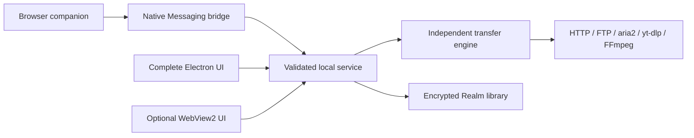

# Development and building

## Requirements

Windows x64, Node.js 22.12+ and npm. Node 22 is the tested build line. The native host uses Windows .NET Framework's `Framework64/v4.0.30319/csc.exe`. Network access is needed for npm, Electron, Realm and FFmpeg dependency downloads.

```powershell
npm ci
npm run native
npm test
npm start
```

`npm run web` starts the same Node/Realm service with a browser UI. It is not a standalone static website and lacks some desktop capabilities. The default address is `127.0.0.1:17863`; stop another Flow instance before using the same port.

## Build

```powershell
npm run dist
```

Outputs: `release/Flow-2.7.0-Setup.exe` and `release/Flow-2.7.0-Portable.exe`. `npm run pack` creates an unpacked app. Runtime/dependencies are pinned in the lockfile; `npmRebuild: false` preserves the Realm distribution used here.

The official independent `vendor/yt-dlp.exe` has version, SHA-256 and licenses in `vendor/`. Verify hashes and update notices when replacing it. Electron supplies the JavaScript runtime; FFmpeg comes from `ffmpeg-static`. End users need no separate Node or Python installation.

## Verification

```powershell
node scripts/verify-source.cjs
npm test
npm audit --omit=dev
```

Tests use isolated temporary databases and local HTTP/FTP fixtures. They check actual bytes, pause/resume, errors, authorized handoff, quotas, rescue and media. Windows native tests need the compiled host. Local tests do not prove live website or personal-browser behavior.

## Optional compact Windows build

Run `./scripts/build-compact-windows.ps1` after `npm ci` and `npm run native`. It downloads pinned official build inputs, verifies their SHA-256 fingerprints, compiles the Windows host with its DPI manifest, and stages all production dependencies. Existing stage directories are never overwritten. The package uses complete official Node, FFmpeg, aria2 and yt-dlp tools; Windows packages omit only the duplicate standalone extractor and mobile Realm development archives.

Build the compact portable launcher with `node scripts/build-compact-portable.cjs <staged directory> <makensis.exe> <output.exe>`. Its versioned cache remains present while the independent engine runs. The optional GitHub workflow builds both compact packages into an existing draft and fails if either exceeds 70,000,000 bytes.

Compact Preview requires shared Microsoft WebView2 and .NET Framework 4.8. Those prerequisites are checked before replacing an existing installation. Keep the complete Electron edition available; see [preservation and validation](COMPACT-WINDOWS-PREVIEW.md).

## Project responsibilities



The two desktop hosts use the same interface and service code. Compact Preview
uses a full official Node process outside the UI; its versioned portable runtime
remains available while transfers continue.

| Path | Responsibility |
| --- | --- |
| `src/electron.cjs`, `src/windows.cjs` | Main process, tray, IPC and tool windows |
| `src/service.cjs`, `src/server.cjs` | Validated actions and authenticated local service |
| `src/engine.cjs`, `src/network.cjs` | Transfers, segments, validation and transport |
| `src/store.cjs` | Encrypted Realm schemas and settings |
| `src/native-backend.cjs`, `src/native-profile.cjs` | Compact service, library ownership and migration backup |
| `native/FlowWebView.cs`, `native/webview-bridge.js` | Optional Windows WebView2 host and explicit action bridge |
| `src/library.cjs`, `src/smart.cjs` | Organization, recovery, integrity and rescue |
| `src/power.cjs`, `src/automation.cjs`, `src/workshop.cjs` | Link tools, rules, traffic and media |
| `src/video.cjs`, `src/grabber.cjs` | Website extraction and static site capture |
| `ui/`, `extension/`, `native/`, `test/` | Shared UI, browser companion, C# bridge and tests |

Never commit runtime databases, keys, browser profiles, host configuration, session data, downloads or release executables. Put binaries in GitHub Releases. Release verification scripts are provided for local Windows use; do not interpret their presence as a successful GitHub Actions run.
