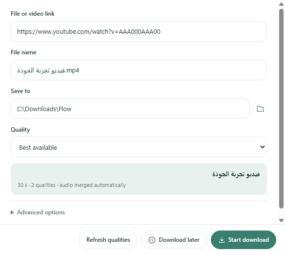
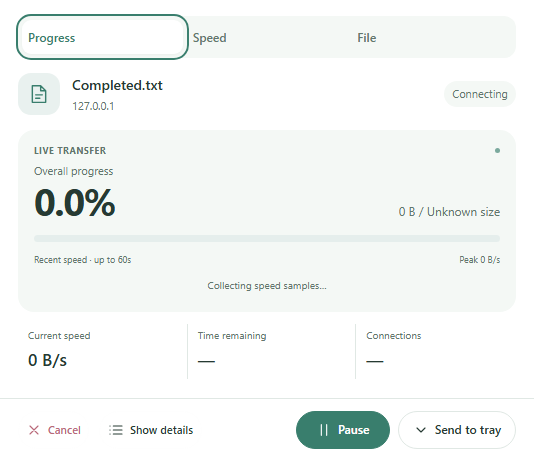
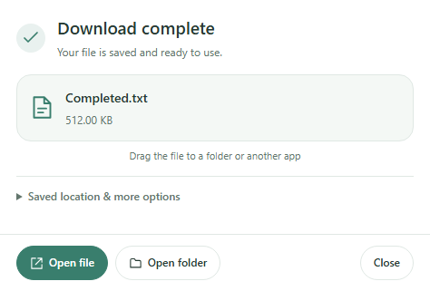
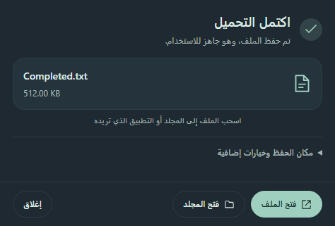

# Download experience in Flow 2.8

## One decision at a time

Paste a link or send it from the browser. A separate compact confirmation shows the save location and video quality where applicable. A visible inspection status explains why Download is temporarily disabled. Successful inspection unlocks the buttons; changing the link or authentication fields requires a new check. A failed check leaves a readable message, retry control and source-page action where appropriate.

Video resolutions are grouped to avoid duplicate codec rows. Best available merges audio automatically; audio-only produces MP3. A watch URL containing a playlist parameter remains a single video. An explicit playlist URL previews its entries inside the same confirmation flow, with all/individual selection and duplicate skipping.

## Completion and files

Completion replaces the corresponding progress window. Open file opens the file, while Open folder selects it in its folder. The file card can be dragged to a folder or another application using the host's native file-drop API. The application validates the completed task and file before allowing a drag. The receiving application and Windows decide how a drop is handled.

Technical file paths, connection ranges and detailed problem reports stay collapsed. Native text-field context menus provide copy/paste and standard edit commands. English, Arabic RTL, light and dark appearances share the same layout.

## Video inspection and access

The independent transfer engine performs both metadata inspection and downloading. Fresh results are shared only in memory and keyed by the resource, session headers and proxy. Signed URLs are not put in the public UI or persisted as an inspection cache. Changed browser authentication triggers a new extraction. Failed extractor downloads discard their cached metadata before a retry.

YouTube can still require sign-in, verification or restrict access by account, region or network. Flow does not bypass those restrictions or decrypt DRM. After completing a requested check in the browser, send the page from Flow Companion again so the app receives the current authorized session. Pasting a link alone does not transfer browser cookies.

The implementation follows [Electron's native file-drag API](https://www.electronjs.org/docs/latest/tutorial/native-file-drag-drop) and uses the bundled extractor and JavaScript runtime described in [yt-dlp's runtime setup](https://github.com/yt-dlp/yt-dlp/wiki/EJS).

## Validation boundaries

Source tests, controlled UI tests, full public video downloads, playlist inspection/import, packaged tests and installer verification are separate checks. The native drag IPC and validated file payload were exercised; a physical Explorer drop is not represented as a completed automated test. Public video successes on the test connection do not prove unrestricted access on every user's connection. The full 25-video playlist was inspected and imported; all 25 video payloads were not downloaded for this audit.

Windows 10/11 x64 remain the supported platforms. Compact Preview still requires WebView2 and .NET Framework 4.8. Signing and Linux packaging have not changed in this update.

## Actual interface captures

Captured from a packaged 2.8 application in an isolated profile. The quality preview uses controlled example metadata; progress/completion use a real local fixture. These images are not public-website or speed evidence.

[Exact validation results](../VALIDATION.md)
