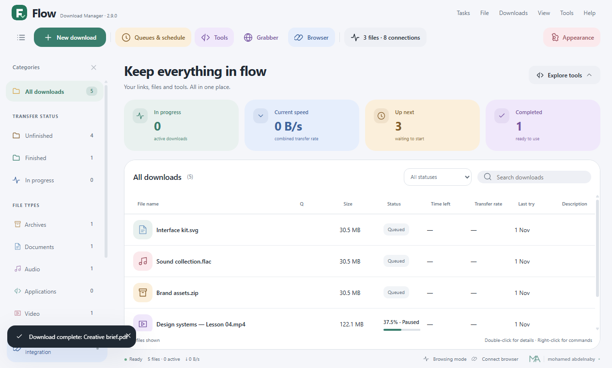
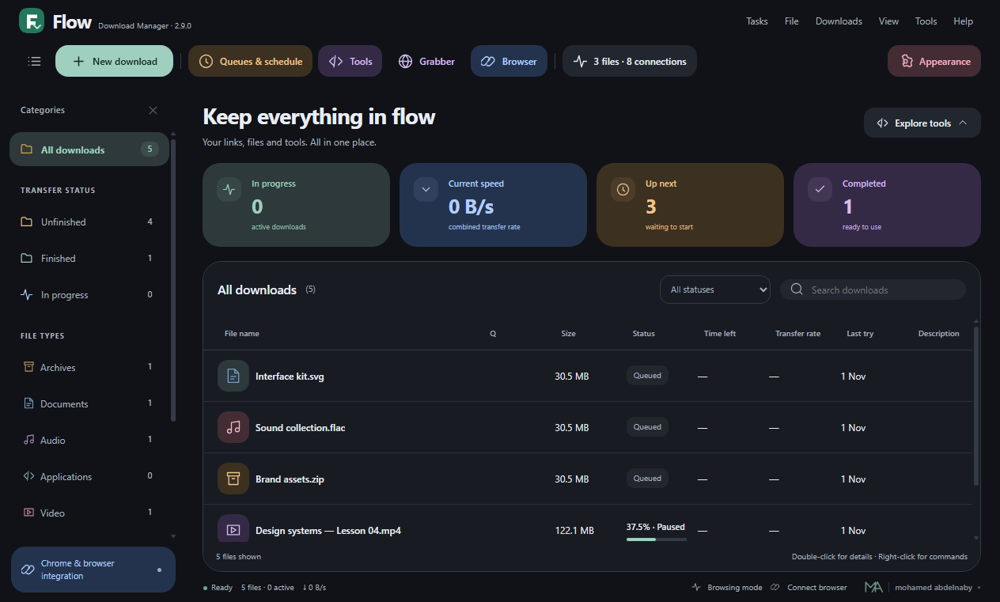
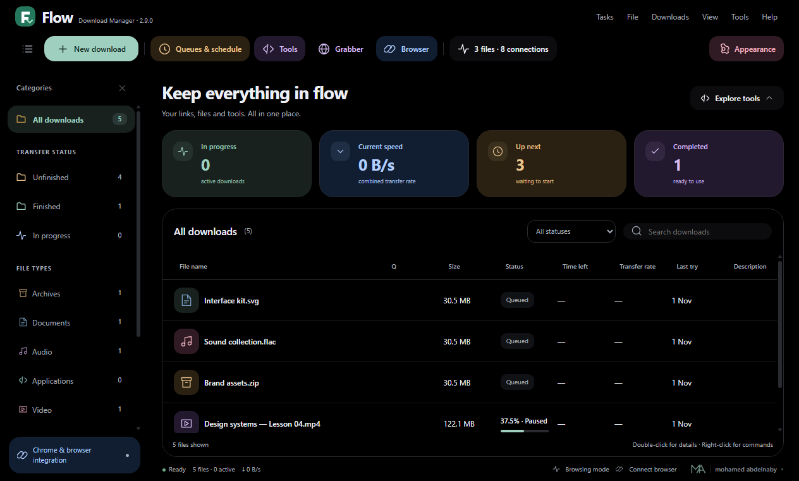
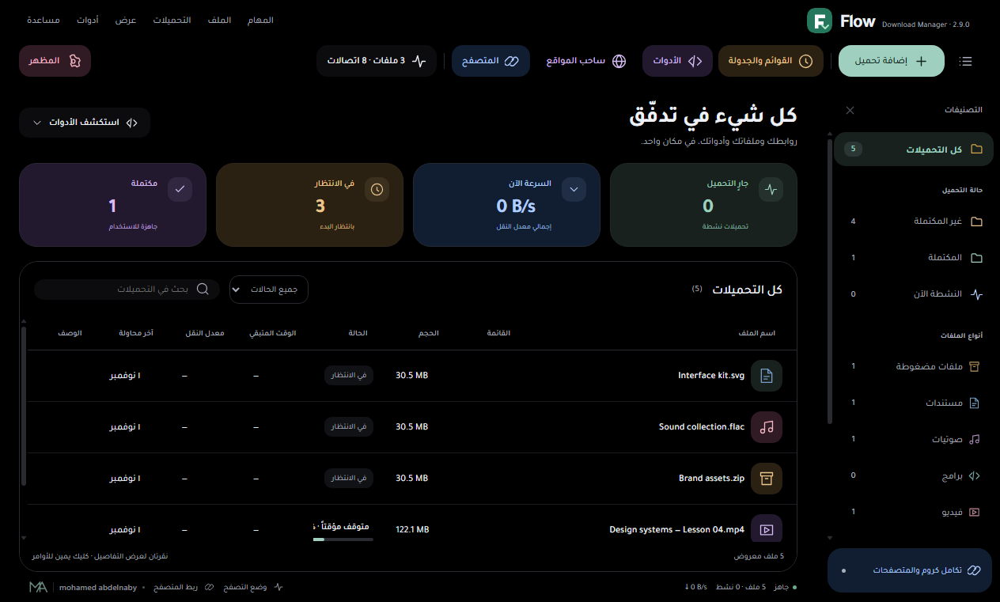
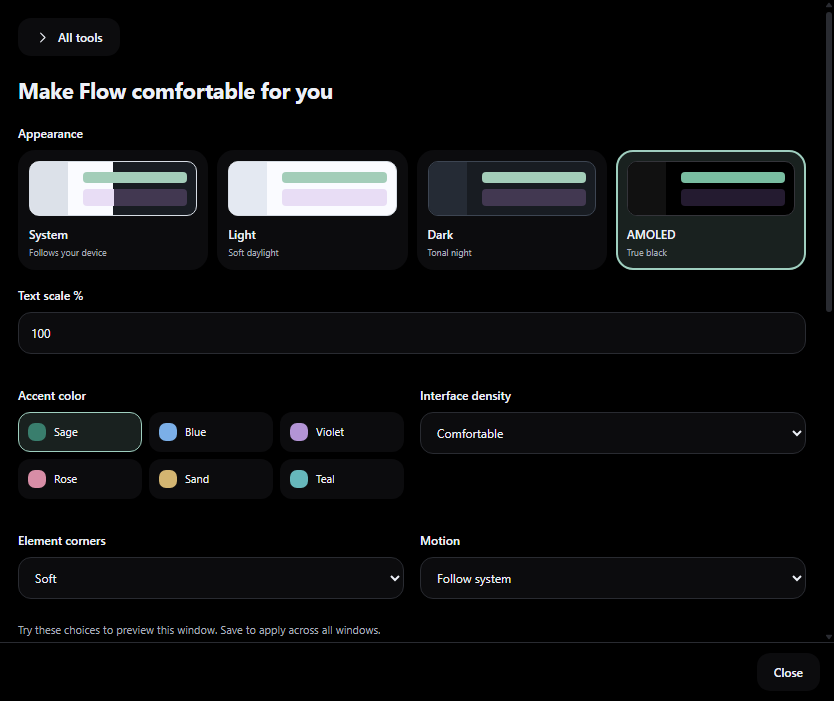
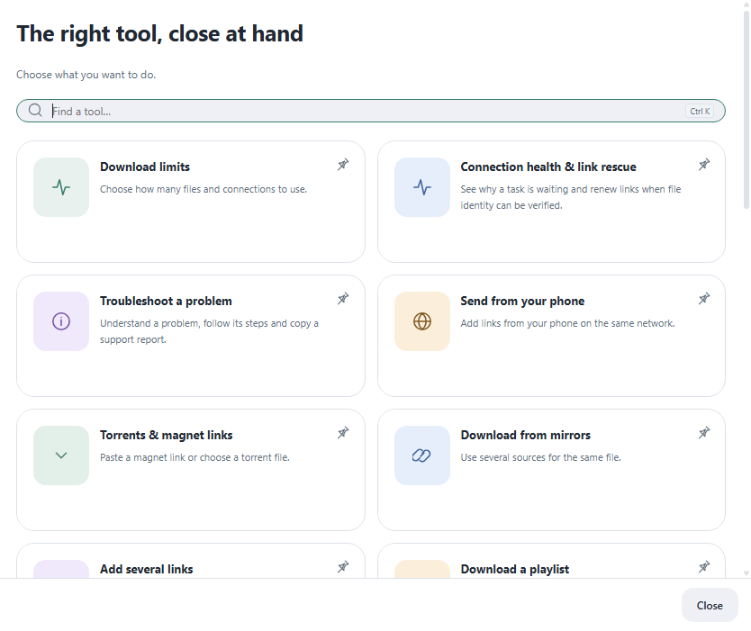

# Flow 2.9 — Material You workspace

A shared visual system for the main workspace, confirmation and transfer windows, completion, settings, queues, library, smart tools, productivity, browser integration, update and recovery screens. Existing download commands and storage are retained.

## Color with a purpose

Sage identifies transfer activity and primary actions. Blue supports speed and connection tools, amber identifies waiting and scheduling, violet highlights completed files and creative tools, and rose marks media or issues. A six-color accent picker changes the main emphasis while supporting roles keep their meaning. The implementation uses local CSS and JavaScript, without adding a web framework or remotely loaded UI assets.

## Four appearances

- **System** follows the device's light or dark appearance.
- **Light** uses soft neutral surfaces and restrained color containers.
- **Dark** uses charcoal surfaces with visible tonal layers.
- **AMOLED** uses a true-black base, with borders and subdued colored containers to keep controls distinguishable. It is an explicit preference and does not turn off when the system changes.

Choose **Appearance** in the main toolbar or open Settings. The visual chooser previews this window; **Save preferences** applies it across windows. Unsaved choices are restored when leaving the appearance panel. Density, corners, fonts, labels, sidebar width and reduced motion remain configurable.

Arabic uses bundled Tajawal, including offline operation. English and Arabic share the same controls and support LTR/RTL. A compact layout hides decorative overview cards at very short window heights so the transfer list stays usable at 150% text scale.

The desktop drop target and companion popup use the same family of surfaces. The companion receives the saved appearance over the existing authenticated desktop connection; reload the unpacked extension once after updating. The remote phone page follows that phone's system appearance.

## Captured from the application

Isolated example records are used in the gallery; they are not internet-speed evidence.

## Design references

The visual direction is informed by the official [Material 3 color-role guidance](https://developer.android.com/develop/ui/compose/designsystems/material3) and [type roles](https://m3.material.io/styles/typography/applying-type). Flow implements its own HTML/CSS/JavaScript presentation and keeps its existing Electron and compact desktop hosts.

[Validation](../VALIDATION.md) · [Updating](UPDATING.md)
