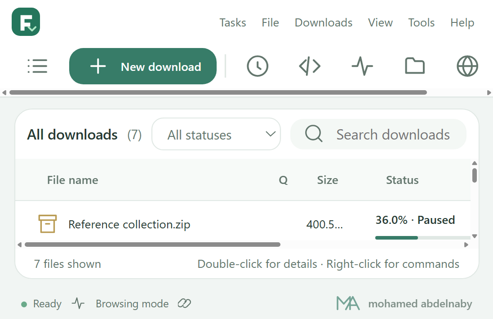
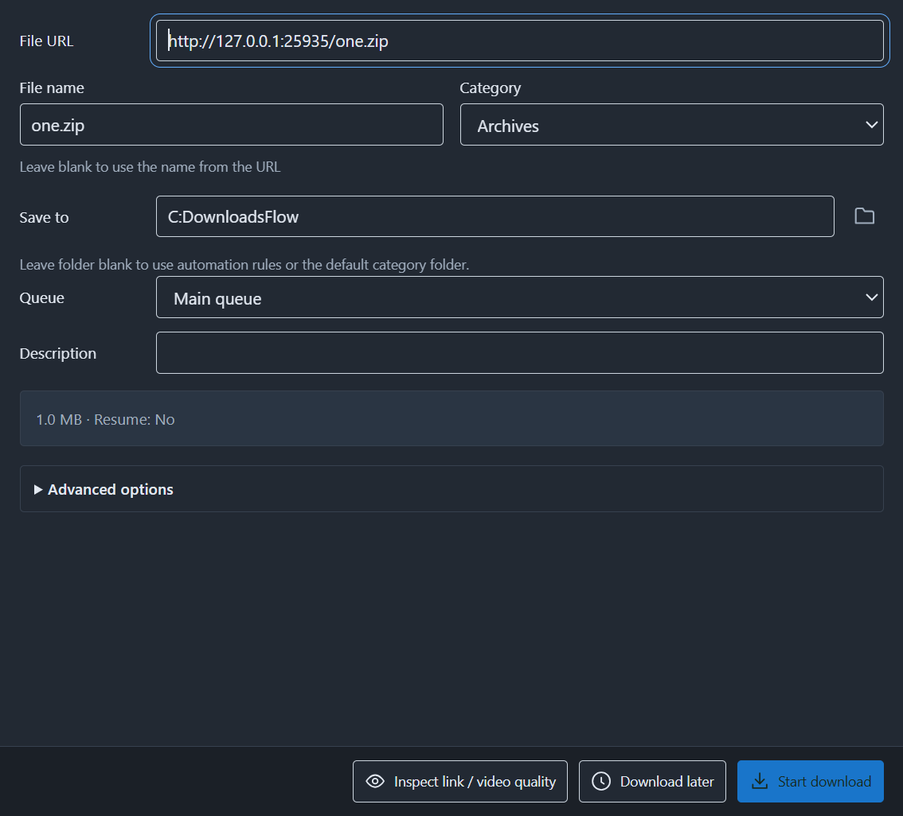
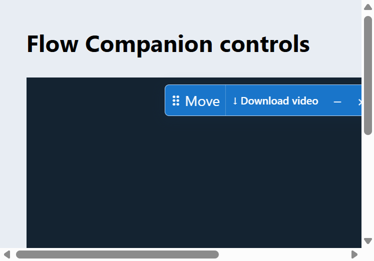
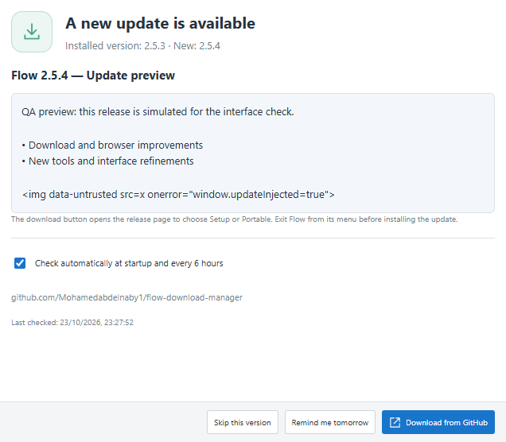
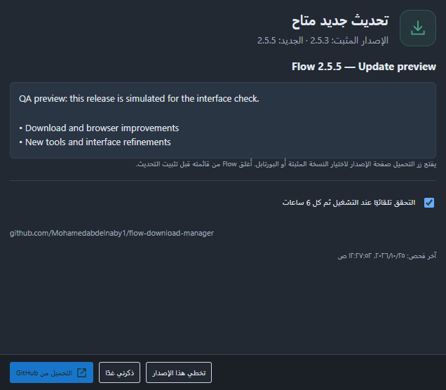
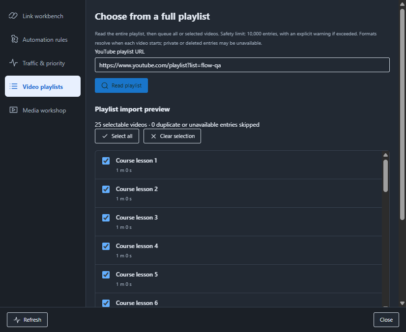
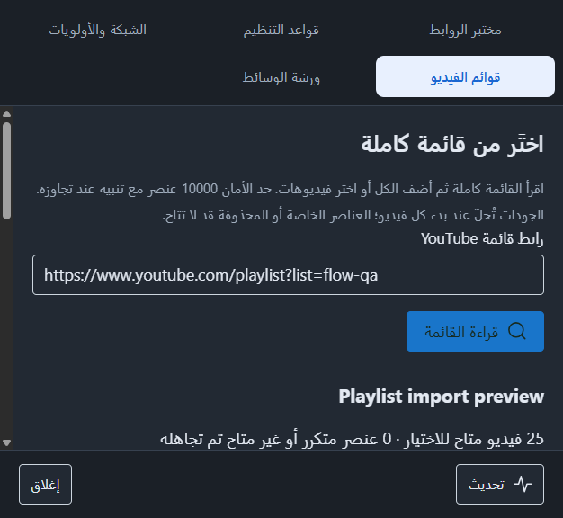

# Screenshots

Actual Flow 2.5.2 portable desktop captures with demonstration records and example names. No private browsing session or token is shown. Demonstration entries do not imply their example URLs were downloaded.

| View | Capture |
| --- | --- |
| English desktop, light |  |
| English desktop, dark |  |
| Settings |  |
| Favorites and capacity |  |
| Batch rename |  |
| Productivity |  |
| Smart tools |  |
| Compact layout |  |

The app UI is real. Browser API fixture captures are labeled separately in validation and do not prove personal Chrome/Edge installation.

## Reported-problem regression captures

The confirmation is a separate packaged desktop window with the main window hidden. The panel capture runs the actual companion content script in Chromium with controlled Chrome API fixtures; it is not a personal browsing screenshot.

| View | Capture |
| --- | --- |
| Independent confirmation |  |
| Updated movable panel |  |

## Update notifications in 2.5.3

These are real packaged update-window captures using simulated future release data; the version shown is a preview, not a published update.

| English | Arabic / system dark |
| --- | --- |
|  |  |

### Playlist importer in 2.5.3

| English | Arabic / compact layout |
| --- | --- |
|  |  |

These are controlled playlist UI previews. Live inspection/download evidence is recorded separately.
