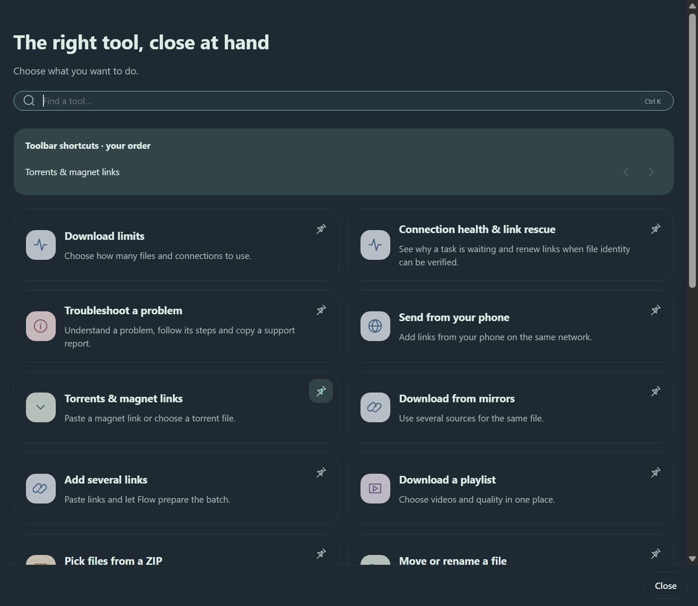

# Inside Flow

## Three tasks, three live GIFs

### Search and pin a tool

### Resume and finish a download

### Change your appearance

These are three separate continuous recordings of actual mouse and keyboard actions in the installed Flow 2.7.1 application. The cursor is a synchronized recording overlay; tool windows are placed over the captured workspace. Library records are demonstration data in an isolated profile. The download GIF records a completed 3 MiB local fixture and is not an internet-speed comparison. [Capture notes](demos/capture-notes.json).

<b>Reference stills — light, dark and Arabic RTL</b>

[Download](../README.md#choose-your-flow) · [Tools guide](TOOLS.md) · [Validation](../VALIDATION.md)

These are actual application captures from the shared 2.7 interface. Demonstration records illustrate the library; their example URLs are not claimed as successful downloads. Transfer and completion captures use one real controlled 8 MiB local transfer. Screenshots keep their natural proportions.

## A calmer workspace

An integrated toolbar, clear transfer states and the tools you choose to pin. The footer keeps creator attribution within the workspace.

## Your tools, close at hand

<table><tr><td width="50%"> <b>Search by task.</b></td><td width="50%"> <b>The same toolkit after dark.</b></td></tr></table>

Each tool has a separate pin control. Pinning adds a shortcut; removing a shortcut keeps the tool and its settings.

## Small windows, useful detail

<table><tr><td width="55%"> <b>Actual local transfer in progress.</b></td><td width="45%"> <b>Completion without a large empty window.</b></td></tr></table>

## Make it comfortable

Accent colors, density, corners, motion, fonts, toolbar labels and columns. Save to apply across windows; previewing does not discard your stored setup.

## Light, dark and Arabic RTL

The source capture check passed 45 appearance/localization checks. Browser panel tests use controlled browser-API fixtures and are documented separately. Native Messaging, actual browser installation, public video transfers and installer tests have separate evidence; a gallery image does not stand in for those checks.

Older version captures remain in the parent screenshots folder for historical validation links. [Current capture notes](screenshots/v2.7/capture-notes.json).

